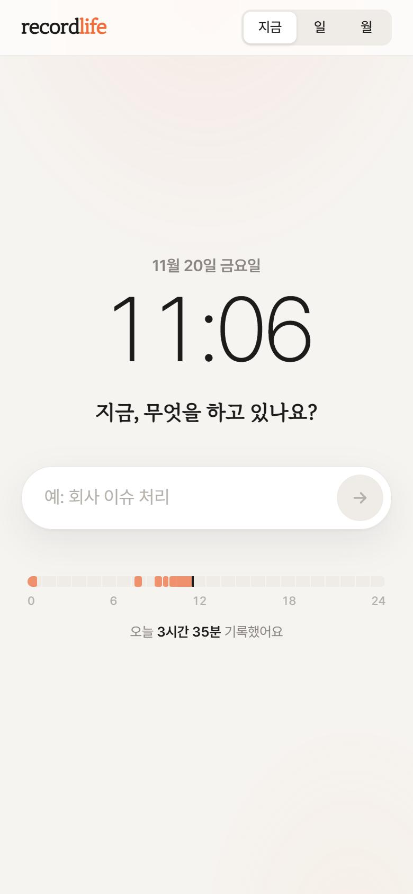
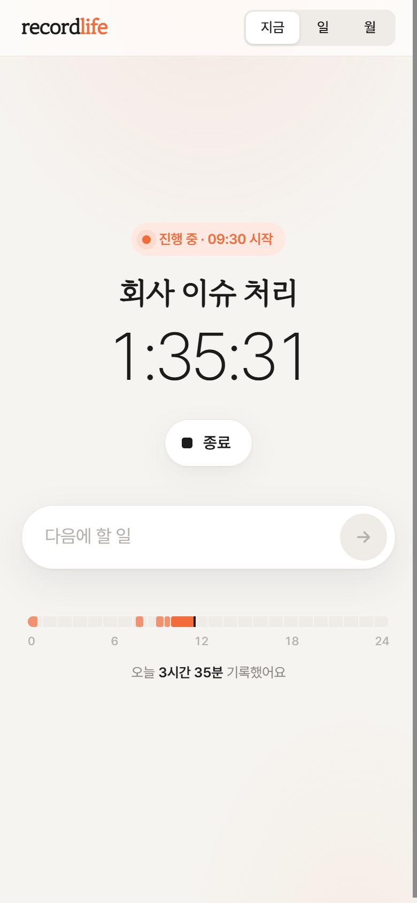
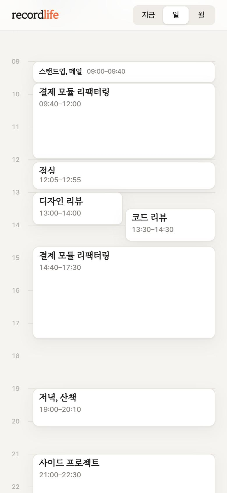
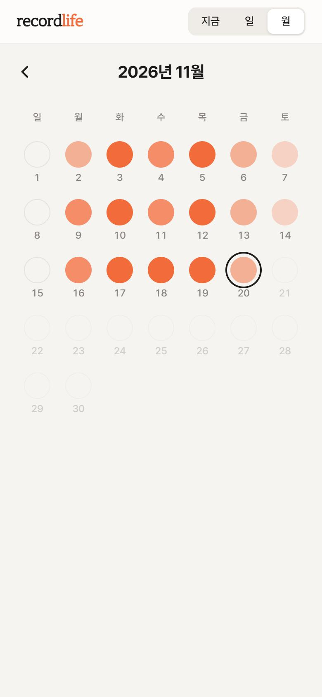
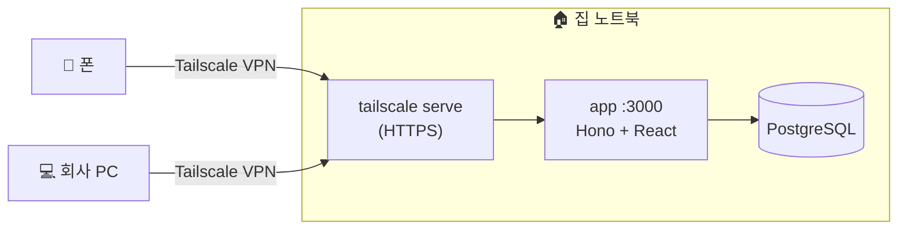

<div align="center">


# recordlife

**지금 뭐 하고 있는지 한 줄로 적으면, 하루가 시간 블록으로 남습니다.**

입력하고 Enter. 끝나면 종료. 그게 전부인 1인용 활동 기록 앱.


<br />

<table>
  <tr>
    <td align="center"><br /><sub><b>지금</b> · 입력칸 하나로 시작</sub></td>
    <td align="center"><br /><sub><b>진행 중</b> · 새로고침해도 이어지는 타이머</sub></td>
    <td align="center"><br /><sub><b>일</b> · 24시간 시간 블록</sub></td>
    <td align="center"><br /><sub><b>월</b> · 많이 할수록 진해지는 원</sub></td>
  </tr>
</table>

</div>

---

## 왜 만들었나

타임 트래커는 대부분 프로젝트, 태그, 카테고리부터 정하라고 합니다. 정작 기록하고 싶은 순간에는 그럴 여유가 없죠.

recordlife는 반대로 갑니다. **지금 하는 일을 한 줄로 적는 것**만 합니다. 분류는 없고, 기록은 시간 블록으로 쌓이고, 빈 시간은 그대로 여백으로 남습니다. 하루가 끝나면 내가 실제로 어디에 시간을 썼는지가 한눈에 보입니다.

## 기능

- **한 줄로 시작** — 입력하고 Enter. 시작 시각은 서버 시각으로 기록됩니다.
- **끊기지 않는 타이머** — 새로고침, 브라우저 종료, 다른 기기로 옮겨도 진행 중인 기록이 그대로 이어집니다.
- **자동 전환** — 진행 중에 다음 일을 입력하면 이전 기록은 그 순간 자동으로 종료됩니다.
- **오늘 리본** — 첫 화면 아래 얇은 24시간 막대로 오늘의 흐름을 봅니다.
- **일 보기** — 몇 시부터 몇 시까지 뭘 했는지 시간 블록으로. 겹치는 기록은 나란히, 자정을 넘긴 기록은 양쪽 날에 나눠서 보여 줍니다.
- **고치기** — 종료를 깜빡했다면 블록을 눌러 이름·시작·종료 시각을 수정하거나 삭제합니다.
- **월 보기** — 날마다 원 하나. 기록 시간이 많을수록 진해집니다 (0 / ~2h / ~4h / ~6h / 6h+).
- **폰과 PC 모두** — 반응형. 홈 화면에 추가해 앱처럼 쓸 수 있습니다.

## 빠른 시작

[Docker](https://www.docker.com/)만 있으면 됩니다.

```bash
git clone https://github.com/KoulLife/recordlife.git
cd recordlife
docker compose up -d --build
```

브라우저에서 <http://localhost:3000> 을 엽니다. 끝.

- 데이터는 Docker 볼륨(`pgdata`)에 저장되어 컨테이너를 다시 만들어도 남습니다.
- 두 컨테이너 모두 `restart: unless-stopped` 라서 재부팅 후 자동으로 다시 뜹니다 (Docker가 부팅 시 실행되도록 설정해 두세요).

업데이트:

```bash
git pull && docker compose up -d --build
```

## 집 서버로 쓰기 (Tailscale)

recordlife는 **집에 남는 노트북 한 대 + VPN** 구성을 전제로 합니다. 앱 자체에는 로그인이 없고, 포트는 노트북 자신(`127.0.0.1`)에만 열려 있습니다. 같은 와이파이의 다른 기기에서도 직접 접근할 수 없습니다.



1. 노트북과 폰에 [Tailscale](https://tailscale.com/download)을 설치하고 같은 계정으로 로그인합니다.
2. 노트북에서 한 번 실행합니다 (재부팅 후에도 유지됩니다).

   ```bash
   tailscale serve --bg 3000
   ```

3. 폰이나 다른 PC에서 `https://<노트북 이름>.<tailnet>.ts.net` 으로 접속합니다. HTTPS라서 홈 화면에 추가할 수 있습니다.

> [!WARNING]
> 인증이 없으므로 `tailscale funnel` 이나 공유기 포트포워딩으로 인터넷에 공개하지 마세요.

## 백업과 복구

```bash
# 백업
docker compose exec db pg_dump -U recordlife recordlife > backup.sql

# 복구
docker compose exec -T db psql -U recordlife recordlife < backup.sql
```

## 구조

```
recordlife/
├─ shared/   시간 계산 유틸과 타입 (Asia/Seoul 날짜 경계, 자정 분할, 월별 합산)
├─ server/   Hono API + Drizzle ORM + PostgreSQL, 운영 시 web 빌드 결과도 서빙
├─ web/      React 19 + Vite + React Router (지금 / 일 / 월)
├─ docker-compose.yml   app + db
└─ Dockerfile           멀티스테이지 빌드
```

| 영역 | 사용 기술 |
|---|---|
| 프론트엔드 | React 19, Vite, React Router 7, 순수 CSS (디자인 토큰) |
| 백엔드 | Node 22, Hono 4, Zod |
| 데이터 | PostgreSQL 17, Drizzle ORM (시작 시 자동 마이그레이션) |
| 날짜 | date-fns + @date-fns/tz (모든 계산을 `Asia/Seoul` 기준으로) |
| 테스트 | Vitest (실제 Postgres에 붙는 API 통합 테스트, jsdom 컴포넌트 테스트) |
| 배포 | Docker Compose, pnpm workspace |

### 시간 처리 원칙

- 시각은 DB에 UTC(`timestamptz`)로 저장하고, 날짜 경계와 표시는 항상 `Asia/Seoul` 입니다. 서버나 컨테이너의 시간대 설정에 영향받지 않습니다.
- 시작·종료 시각은 **서버 시각**을 씁니다. 기기마다 시계가 달라도 기록이 어긋나지 않고, 화면의 타이머는 서버와의 시차를 보정합니다.
- 진행 중인 기록은 DB 제약(`one_running` 부분 유니크 인덱스)으로 항상 최대 1개입니다. 두 기기에서 동시에 시작해도 마찬가지입니다.

### API

| 메서드 | 경로 | 설명 |
|---|---|---|
| `GET` | `/api/current` | 진행 중인 기록과 서버 시각 |
| `POST` | `/api/activities/start` | `{ title }` 로 시작 (진행 중이던 기록은 자동 종료) |
| `POST` | `/api/activities/:id/stop` | 지금 시각으로 종료 |
| `PATCH` | `/api/activities/:id` | `{ title?, startedAt?, endedAt? }` 수정 |
| `DELETE` | `/api/activities/:id` | 삭제 |
| `GET` | `/api/days/:yyyy-mm-dd` | 그날과 겹치는 기록 목록 |
| `GET` | `/api/months/:yyyy-mm` | 날짜별 기록 분 `{ "2026-11-20": 215, ... }` |

## 개발

Node 22, pnpm 10, Docker가 필요합니다.

```bash
cp .env.example .env
docker compose up -d db
pnpm install
pnpm dev
```

- 웹: <http://localhost:5173> (`/api` 는 3000으로 프록시)
- API: <http://localhost:3000>
- 개발 중에는 `docker compose stop app` 으로 앱 컨테이너를 내려 3000 포트를 비워 두세요.

```bash
pnpm test                              # shared · server · web 전체 테스트
pnpm --filter server db:generate       # 스키마 변경 후 마이그레이션 생성
```

서버 테스트는 같은 Postgres의 `recordlife_test` 데이터베이스를 사용합니다 (`docker compose up -d db` 가 처음 뜰 때 자동 생성).

## 디자인

애플 기본 앱의 문법(라지 타이틀, 그룹 리스트, 반투명 바) 위에, 사용자가 쓴 글만 세리프(마루부리)로 보여 줍니다. 포인트 색은 Ember `#F26B3A` 하나뿐입니다.

- 디자인 시스템: [`DESIGN.md`](DESIGN.md)
- 설계 문서: [`docs/superpowers/specs/2026-11-20-recordlife-design.md`](docs/superpowers/specs/2026-11-20-recordlife-design.md)

## 로드맵

- [ ] 지나간 시간에 기록 직접 추가
- [ ] 폰트 self-host (현재 CDN)
- [ ] 오프라인에서 시작/종료 후 나중에 동기화
- [ ] 주간·연간 회고 화면

## 라이선스

[MIT](LICENSE) © KoulLife
